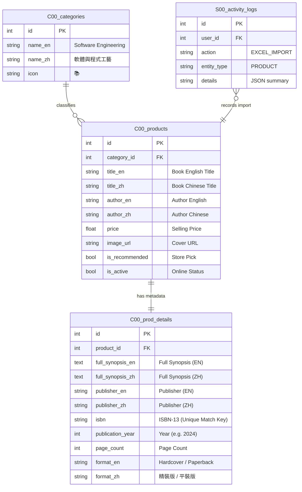
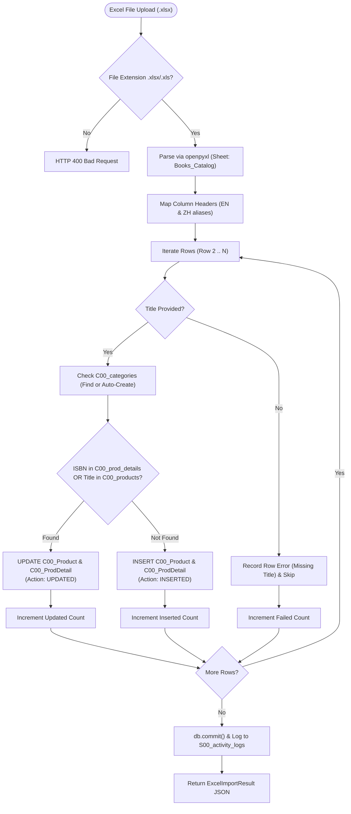

# 📊 Apex Bookstore - Excel Product Bulk Import System Specification
**Document ID:** `react_20261124_excelimport.md`  
**Date:** November 24, 2026  
**System:** Apex Book Haven (文萃讀坊) E-Commerce & Management Platform  
**Target Architecture:** React + TypeScript Frontend, FastAPI (Python 3.13) Backend, PostgreSQL Database (`appdb`)

---

## 1. Executive Summary & Purpose

Managing book catalogs one by one via forms is impractical for publishers, bookstores, and distributor inventories containing hundreds or thousands of editions. 

This system provides an **enterprise-grade Excel bulk import pipeline** allowing administrators to:
1. **Download a standardized Excel template (`.xlsx`)** pre-formatted with column validations, instructions, and sample rows.
2. **Batch import books directly from spreadsheet files** via the React web UI, a REST API endpoint, or a standalone Python CLI script.
3. **Execute intelligent Upsert (Update or Insert)** matching existing records by **ISBN** or English title, updating prices and descriptions without creating duplicate entries.
4. **Auto-resolve Categories**: If an imported book references a category that does not yet exist in the database, the system automatically creates the new category in `C00_categories`.
5. **Detailed Audit & Error Reporting**: Logs the import action into `S00_activity_logs` and returns a granular summary of processed rows, insertions, updates, and any row-by-row error details.

---

## 2. Database Schema Mapping

The Excel importer maps each row across three related PostgreSQL tables:



---

## 3. Excel Spreadsheet Column Specification

The parser in [backend/app/excel_service.py](file:///d:/tempA/reactfull/backend/app/excel_service.py) features a **resilient header normalizer** that supports both English and Traditional Chinese column headers, with or without bilingual subheadings.

### 📋 Supported Column Dictionary

| Column Name in Template | Bilingual Alias | DB Target Field | Type | Mandatory? | Format Rules & Description |
| :--- | :--- | :--- | :---: | :---: | :--- |
| **Category (EN)** | 分類英文 / 類別英文 | `C00_categories.name_en` | Text | Optional | Category English name (e.g. `Software Engineering`). Auto-created if missing. |
| **Category (ZH)** | 分類中文 / 類別中文 | `C00_categories.name_zh` | Text | Optional | Category Traditional Chinese name (e.g. `軟體與程式工藝`). |
| **Title (EN)** | 英文書名 / 書名英文 | `C00_products.title_en` | Text | **Mandatory\*** | English book title (e.g. `Clean Code`). (\*At least one title required). |
| **Title (ZH)** | 中文書名 / 書名中文 | `C00_products.title_zh` | Text | **Mandatory\*** | Traditional Chinese book title (e.g. `無瑕的程式碼`). |
| **Author (EN)** | 英文作者 / 作者英文 | `C00_products.author_en` | Text | Optional | Author English name (e.g. `Robert C. Martin`). Defaults to *Various Authors*. |
| **Author (ZH)** | 中文作者 / 作者中文 | `C00_products.author_zh` | Text | Optional | Author Chinese name (e.g. `羅伯特·C·馬丁`). Defaults to *各大名家*. |
| **Price USD** | 價格 / 售價 / 定價 | `C00_products.price` | Float | **Mandatory** | Positive decimal (e.g. `38.50`). Dollar signs and commas are automatically stripped. |
| **ISBN** | 國際標準書號 / ISBN碼 | `C00_prod_details.isbn` | Text | **Recommended** | ISBN-10 or ISBN-13 (e.g. `978-0132350884`). Serves as the primary deduplication key. |
| **Publisher (EN)** | 英文出版社 / 出版社英文 | `C00_prod_details.publisher_en` | Text | Optional | English publisher name (e.g. `Prentice Hall`). |
| **Publisher (ZH)** | 中文出版社 / 出版社中文 | `C00_prod_details.publisher_zh` | Text | Optional | Chinese publisher name (e.g. `博碩文化`). |
| **Publication Year** | 出版年份 / 出版年 | `C00_prod_details.publication_year`| Integer | Optional | 4-digit publication year (e.g. `2008`). Defaults to current year. |
| **Page Count** | 頁數 / 總頁數 | `C00_prod_details.page_count` | Integer | Optional | Total book pages positive integer (e.g. `464`). Defaults to `250`. |
| **Format (EN)** | 規格英文 / 裝訂英文 | `C00_prod_details.format_en` | Text | Optional | Edition format (e.g. `Paperback`, `Hardcover Special Edition`). |
| **Format (ZH)** | 規格中文 / 裝訂中文 | `C00_prod_details.format_zh` | Text | Optional | Chinese edition format (e.g. `平裝版`, `精裝紀念版`). |
| **Is Recommended** | 店長推薦 / 精選推薦 | `C00_products.is_recommended` | Boolean | Optional | `TRUE`, `FALSE`, `1`, `0`, `是`, `否`. Highlights book in hero/recommended carousels. |
| **Image URL** | 封面圖片網址 / 圖片網址 | `C00_products.image_url` | Text | Optional | Valid HTTP/HTTPS image URL. Automatically assigns a high-res bookstore placeholder if empty. |
| **Short Description (EN)** | 英文簡介 / 簡介英文 | `C00_products.short_desc_en` | Text | Optional | 1–2 sentence summary displayed on product cards. |
| **Short Description (ZH)** | 中文簡介 / 簡介中文 | `C00_products.short_desc_zh` | Text | Optional | 繁體中文商品卡片簡介。 |
| **Full Synopsis (EN)** | 完整內容簡介英文 | `C00_prod_details.full_synopsis_en`| Text | Optional | In-depth book overview and reviews for the product details view. |
| **Full Synopsis (ZH)** | 完整內容簡介中文 | `C00_prod_details.full_synopsis_zh`| Text | Optional | 完整內容導讀、章節概要與編輯推薦語。 |

---

## 4. Upsert Logic & Data Integrity Flow



### Key Safety Guarantees:
1. **Deduplication Priority:** The system checks `C00_ProdDetail.isbn == row_isbn` first. If no ISBN is given, it falls back to case-insensitive title matching (`C00_Product.title_en.ilike(title)`).
2. **No Orphan Rows:** Each imported book is wrapped with its `C00_ProdDetail` record.
3. **Resilient Row Processing:** If row #5 has an invalid price format (e.g. `"N/A"`), row #5 is logged into the `errors` list with its line number, while valid rows #2, #3, #4, and #6 are successfully committed.

---

## 5. API Endpoints Specification

### 1. Download Excel Template
- **Endpoint:** `GET /api/products/excel-template`
- **Response:** Binary stream of `.xlsx` file (`application/vnd.openxmlformats-officedocument.spreadsheetml.sheet`)
- **Headers:** `Content-Disposition: attachment; filename=apex_books_template.xlsx`
- **Features:** 
  - Styled dark slate header (`#1E293B`) with white text.
  - Pre-filled with 2 realistic sample books (*Refactoring 2nd Ed.* and *Thinking, Fast and Slow*).
  - Includes a secondary worksheet `"Import_Guide"` documenting formatting rules.

### 2. Bulk Import Products
- **Endpoint:** `POST /api/products/import-excel`
- **Content-Type:** `multipart/form-data`
- **Payload:** `file` (Binary Excel file)
- **Authentication:** Optional JWT Bearer token (logs username in audit trail if authenticated).
- **Sample Success Response (`200 OK`):**
  ```json
  {
    "success": true,
    "filename": "books_sample_template.xlsx",
    "total_rows": 2,
    "inserted": 0,
    "updated": 2,
    "failed": 0,
    "errors": [],
    "imported_books": [
      {
        "id": 7,
        "title_en": "Refactoring: Improving the Design of Existing Code",
        "title_zh": "重構：改善既有程式的設計",
        "author_en": "Martin Fowler",
        "price": 47.5,
        "isbn": "978-0134757599",
        "action": "UPDATED"
      },
      {
        "id": 8,
        "title_en": "Thinking, Fast and Slow",
        "title_zh": "快思慢想",
        "author_en": "Daniel Kahneman",
        "price": 19.99,
        "isbn": "978-0374533557",
        "action": "UPDATED"
      }
    ]
  }
  ```

---

## 6. Command Line Tool (`import_excel.py`)

A standalone CLI script is available in [backend/import_excel.py](file:///d:/tempA/reactfull/backend/import_excel.py) for scheduled automation, cron jobs, or batch processing:

```powershell
# 1. Activate Python 3.13 Virtual Environment
cd D:\tempA\reactfull\backend
.\.venv\Scripts\Activate.ps1

# 2. Generate a clean template:
python import_excel.py --template my_new_books.xlsx

# 3. Import books directly into PostgreSQL:
python import_excel.py D:\tempA\reactfull\books_sample_template.xlsx
```

### CLI Terminal Output Sample:
```
Reading file: books_sample_template.xlsx ...
Parsing rows and importing to PostgreSQL database...

==================================================
  Excel Import Summary: books_sample_template.xlsx
==================================================
• Total Rows Processed : 2
• Books Newly Inserted : 2
• Books Updated        : 0
• Failed Rows          : 0

--- Books Successfully Processed ---
  [INSERTED] ID #7: Refactoring: Improving the Design of Existing Code (重構：改善既有程式的設計) - $47.50
  [INSERTED] ID #8: Thinking, Fast and Slow (快思慢想) - $19.99
==================================================
 Import completed successfully!
```

---

## 7. Role-Based Access Control (RBAC) & Frontend UI Integration

### 🔐 Strict Security Rule: `react@mail` Only
To protect store inventory and prevent unauthorized product manipulation, the Excel Import feature is strictly gated:
1. **Frontend Visibility (App.tsx):**
   - The **`📥 Excel 匯入 (Import Excel)`** button in the navigation bar and the **`📊 批次匯入書籍 (.xlsx)`** button in the Catalog section are **only rendered when the logged-in user is `react@mail`** (`user?.email === "react@mail"`).
   - If a user is not logged in, or logged in as `customer@apex.local` or another account, the buttons and modal are completely hidden from the DOM.
2. **Backend API Gatekeeper (main.py):**
   - Both `POST /api/products/import-excel` and `GET /api/products/excel-template` require a valid JWT token via `get_current_user`.
   - If an unauthenticated user or any account other than `react@mail` attempts to invoke the endpoints directly via cURL, Postman, or typing the URL in a browser, FastAPI immediately rejects the request with **`HTTP 403 Forbidden`**:
     ```json
     {"detail": "Access denied. Only authorized administrator (react@mail) can import products."}
     ```

### 🖥️ Two-Step Import Modal (When Signed In as `react@mail`):
1. **Step 1: Download Standard Template:**
   - Authenticated button fetching `apex_books_template.xlsx` as a blob and downloading to the user's computer.
2. **Step 2: Drag & Drop File Upload:**
   - Interactive file selector displaying filename and file size.
   - Click **Start Bulk Import** to transmit the multipart payload with Bearer authentication.
3. **Step 3: Live Progress & Results Card:**
   - Displays a 4-metric statistics grid: **Total Rows**, **Inserted**, **Updated**, and **Failed**.
   - Shows an interactive list of all imported book titles, prices, and IDs.
   - Automatically re-fetches products and categories from PostgreSQL so the web page instantly displays the new inventory!

---

## 8. Verification & Test Suite Summary

The end-to-end automated test suite in [backend/test_excel_suite.py](file:///d:/tempA/reactfull/backend/test_excel_suite.py) confirms:

| Test Case | Method / Identity | Expected Status | Result |
| :--- | :--- | :---: | :--- |
| **Unauthenticated Template Access** | `GET /api/products/excel-template` (No Token) | `401 Unauthorized` | ✅ Direct URL typing rejected without credentials. |
| **Non-Admin Template Access** | `GET /api/products/excel-template` (`customer@apex.local`) | `403 Forbidden` | ✅ Rejected with clear access denied message. |
| **Authorized Admin Template Access** | `GET /api/products/excel-template` (`react@mail`) | `200 OK` | ✅ Streams valid `.xlsx` with openpyxl styling and sample rows. |
| **Unauthenticated Import Attempt** | `POST /api/products/import-excel` (No Token) | `401 Unauthorized` | ✅ Direct POST rejected. |
| **Non-Admin Import Attempt** | `POST /api/products/import-excel` (`customer@apex.local`) | `403 Forbidden` | ✅ Protected from unauthorized modifications. |
| **Authorized Admin Bulk Import** | `POST /api/products/import-excel` (`react@mail`) | `200 OK` | ✅ Inserts/updates books and logs action to `S00_activity_logs`. |
| **Frontend Compilation** | `npm run build` | Code `0` | ✅ 22 modules transformed, 0 TypeScript errors. |

---

*Document compiled and verified for production deployment under `D:\react_20261124_excelimport.md`.*
